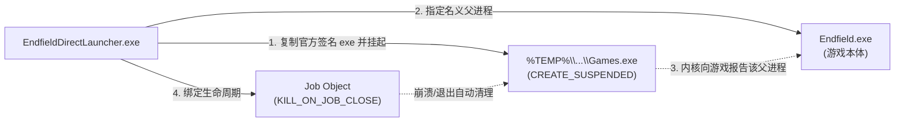

# EndfieldDirectLauncher


绕过《明日方舟：终末地》官方启动器，直接启动 `Endfield.exe` 进入游戏。

把 `EndfieldDirectLauncher.exe` 放到游戏目录（与 `Endfield.exe` 同一层）双击即可，
**不需要**先开鹰角启动器，也不会弹出启动器界面。

---

## 快速使用

### 1. 下载与放置

从仓库 [Releases](../../releases) 下载 `EndfieldDirectLauncher.exe`，放入游戏根目录（即与 `Endfield.exe` 同一级）：

```text
Hypergryph Launcher/games/Endfield Game/
├── Endfield.exe                # 游戏本体
├── EndfieldDirectLauncher.exe  # 👈 放在这里
├── PlatformProcess.exe         # 官方签名助手（本程序借用其签名）
└── ...
```

### 2. 双击直接启动

- 直接双击 `EndfieldDirectLauncher.exe`。
- 首次启动会弹出 UAC 管理员提权确认框（因为游戏本体强制要求管理员权限），确认后直接进入游戏。
- 游戏退出后，启动器会自动完成垃圾清理并安全退出。

> [!TIP]
> **关于游戏更新**：直接启动器不具备游戏下载/补丁更新功能。当游戏提示客户端版本落后时，请先启动一次官方启动器完成热更或下载，更新完毕后继续使用本程序启动。

---

## Steam 整合指南

1. 打开 Steam，点击左下角 **添加游戏** → **添加非 Steam 游戏...**。
2. 浏览选中游戏目录中的 `EndfieldDirectLauncher.exe` 并添加。
3. 在 Steam 库中直接点击“开始游戏”，Steam 会持续显示「运行中」直到游戏完全关闭。

> [!NOTE]
> **Steam 库闪退排查（`steam_appid.txt` 问题）**：
> 如果在 Steam 点击启动后状态仅闪烁一下就消失，是因为此前启动游戏时生成了包含官方 AppID 的 `steam_appid.txt` 文件，导致 Steam 跟踪错乱。
> 本程序会在游戏退出时自动清理该文件；若首次遇到此问题，**手动删除游戏目录中的 `steam_appid.txt` 后重新通过 Steam 启动一次**即可恢复正常。

---

## 命令行与参数透传

程序支持命令行调用，并支持将所有非专有参数**无缝透传给游戏（Unity 引擎）**：

```text
EndfieldDirectLauncher.exe [启动器选项] [--] [游戏透传参数...]
```

### 1. 启动器选项

| 参数 | 说明 |
| :--- | :--- |
| *(无参数)* | 默认模式，静默启动（不弹出黑框控制台窗口）。 |
| `--console` | 额外附加一个控制台窗口，实时输出详细执行流程与调试日志。 |
| `--game-dir <目录>` | 指定 `Endfield.exe` 所在的目录路径（支持 `--game-dir=<目录>`）。 |
| `-h`, `--help` | 输出英文命令行帮助信息与参数格式说明。 |
| `--` | 选项终止符，其后跟随的所有参数将原封不动透传给游戏。 |

### 2. 游戏参数透传（Unity 常用参数）

任何未被启动器占用的参数（如单个 `-` 开头的 Unity 参数）均会自动拼接到游戏启动命令行中：

```bash
# 无边框窗口全屏模式
EndfieldDirectLauncher.exe -popupwindow

# 强制使用 DirectX 11 后端（游戏官方默认走 Vulkan）
EndfieldDirectLauncher.exe -force-d3d11

# 显式指定 Vulkan 后端
EndfieldDirectLauncher.exe -force-vulkan

# 自定义分辨率与全屏状态
EndfieldDirectLauncher.exe -screen-width 1920 -screen-height 1080 -screen-fullscreen 0

# 启动器控制台调试并透传参数
EndfieldDirectLauncher.exe --console -- -popupwindow -force-d3d11
```

> [!TIP]
> 在 Steam 库中右键快捷方式 → **属性** → **启动选项** 中，直接填入如 `-popupwindow -force-vulkan`，即可在 Steam 启动时自动生效。

---

## 工作原理

### 1. 官方启动校验机制

游戏启动并不校验注册表或启动参数，其防护逻辑封装在游戏目录的 `OneChannelLC.dll`（Launch Check 模块）中。在 SDK 初始化阶段，它会通过 Toolhelp 快照获取父进程映像，并执行**严格的双重校验**：

| 校验项 | 校验规则 | 未通过报错 |
| :--- | :--- | :--- |
| **映像名称** | 文件名必须严格为 `Games.exe`（官方启动助手） | `errorCode: 10100` (`Not found matched name`) |
| **数字签名** | 映像必须带有发行商的有效 Authenticode 签名 | `errorCode: 10101` (`TRUST_E_NOSIGNATURE` / `0x800B0100`) |

任一校验未通过，游戏均会阻断加载并提示「请用官方启动器启动」。

### 2. 父进程欺骗（Parent Process Spoofing）

校验模块仅检查父进程的文件名与数字签名，**不限制父进程所在的路径**。因此，本程序通过无损的父进程欺骗机制完成放行：



1. **借用合法签名**：从游戏目录就地取材，复制带有官方发行商签名的可执行文件（优先使用 `PlatformProcess.exe`）至 `%TEMP%\EndfieldDirectLauncher\Games.exe`。
2. **挂起伪父进程**：以 `CREATE_SUSPENDED` 模式启动该临时副本，不执行其任何代码。
3. **设置父进程属性**：通过 Win32 API `UpdateProcThreadAttribute(PROC_THREAD_ATTRIBUTE_PARENT_PROCESS)`，将挂起的 `Games.exe` 指定为游戏的新建父进程。
4. **拉起游戏本体**：以该属性调用 `CreateProcessW` 启动 `Endfield.exe`，内核向游戏报告的父进程即为带合法签名的 `Games.exe`，顺利通过所有检测。
5. **内核级 Job 守护**：游戏拉起后，将临时进程绑定至带有 `KILL_ON_JOB_CLOSE` 的 Windows Job 对象。无论启动器正常退出还是被强制结束，内核均会自动终止占位进程并清理临时文件。

### 3. 对照实验验证

| 启动方式 / 伪造夹具 | 校验结果 | 游戏最终状态 |
| :--- | :--- | :--- |
| 直接双击 `Endfield.exe` | 报 `errorCode: 10100`（父进程名非 `Games.exe`） | 弹窗报错，拒绝进入 |
| 启动器自身伪造为 `Games.exe` | 报 `errorCode: 10101`（无官方数字签名） | 弹窗报错，拒绝进入 |
| 微软已签名的 `notepad.exe` 改名 | 报 `errorCode: 10101`（签名非游戏发行商） | 弹窗报错，拒绝进入 |
| **本程序（提取同目录下官方签名副本）** | **校验通过 (`code: 0`)** | **正常进入渲染 (`HGCreateSwapchain`)** |

---

## 常见问题 (FAQ)

### 会修改游戏文件吗？有封号风险吗？
- **零修改**：程序不读写、不 Patch 任何游戏二进制文件、DLL 或游戏资产，也不注入任何代码。
- **免扫描**：启动后仅等待游戏进程句柄，不在后台轮询扫描游戏进程，不会与反作弊系统（ACE）发生扫描冲突。
- *注：绕过官方启动器非官方支持行为，请自行了解并承担风险。*

### 为什么必须请求管理员权限？
游戏本体 `Endfield.exe` 在应用清单中声明了 `requireAdministrator`（以高完整性级别运行）。普通权限进程无法直接拉起高完整性进程（会抛出 Win32 740 错误 `ERROR_ELEVATION_REQUIRED`）。本程序在自身清单中声明管理员权限，使系统在启动前完成一次性提权，确保进程生命周期受控且 Steam 状态能正常维持。

### Steam 库里只闪烁一下就显示已停止？
游戏运行时会在目录中留下记录官方 AppID（`457962`）的 `steam_appid.txt`，导致 Steam 快捷方式的追踪错位。本程序在游戏退出时会**自动清理**该文件。若初次遇到此问题，**手动删除游戏目录中的 `steam_appid.txt` 后重新通过 Steam 启动一次**即可恢复正常。

### Steam 覆盖层（Shift+Tab）与 F12 截图为什么无法使用？
由于游戏强制以管理员权限（High Integrity）运行，而 Steam 客户端默认以普通权限运行，Windows 内核安全机制禁止低权限进程向高权限进程注入 DLL（`GameOverlayRenderer64.dll`）。此为系统安全机制限制，建议使用显卡驱动覆盖层（如 NVIDIA `Alt+Z`）或游戏内置截图键。

### 游戏出新版本更新时怎么办？
直接启动器不包含游戏下载与热更模块。当游戏提示客户端版本落后时，请先启动一次官方启动器完成更新，更新完成后再继续使用本程序启动。

### 遇到报错或启动异常如何排查？
程序每次运行都会在 exe 同级目录下追加生成 `EndfieldDirectLauncher.log` 日志文件，记录毫秒级时间戳、父进程 PID、游戏 PID、启动参数以及 Win32 错误码。亦可通过命令行传入 `--console` 查看实时调试输出。

---

## 从源码构建与验证

### 本地构建

- 环境要求：Rust 工具链（MSVC target）与 Windows 10/11 SDK（需要自带的 `rc.exe` 编译图标资源）。
- 构建命令：
  ```bash
  cargo build --release
  ```
- 编译产物位于 `target/release/EndfieldDirectLauncher.exe`。

### GitHub 构建来源存证验证 (Attestations)

本项目的 Releases 产物在 GitHub Actions 云端编译时已自动签署构建来源存证，可通过 GitHub CLI 检验防篡改：

```bash
gh attestation verify EndfieldDirectLauncher.exe --repo preca-hoshino/EndfieldDirectLauncher
```

---

## 开源协议与版权声明

- 本项目源码采用 [MIT 许可证](LICENSE) 开源。
- 项目内置提取的图标及游戏相关资产版权归属 **上海鹰角网络科技有限公司**（Shanghai Hypergryph Network Technology Co., Ltd.）所有。

